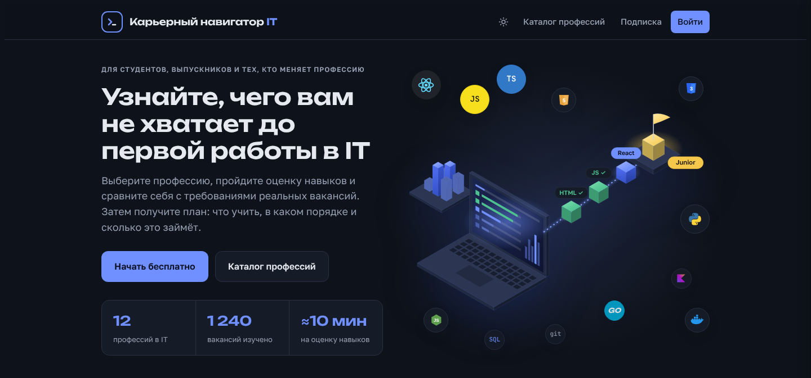
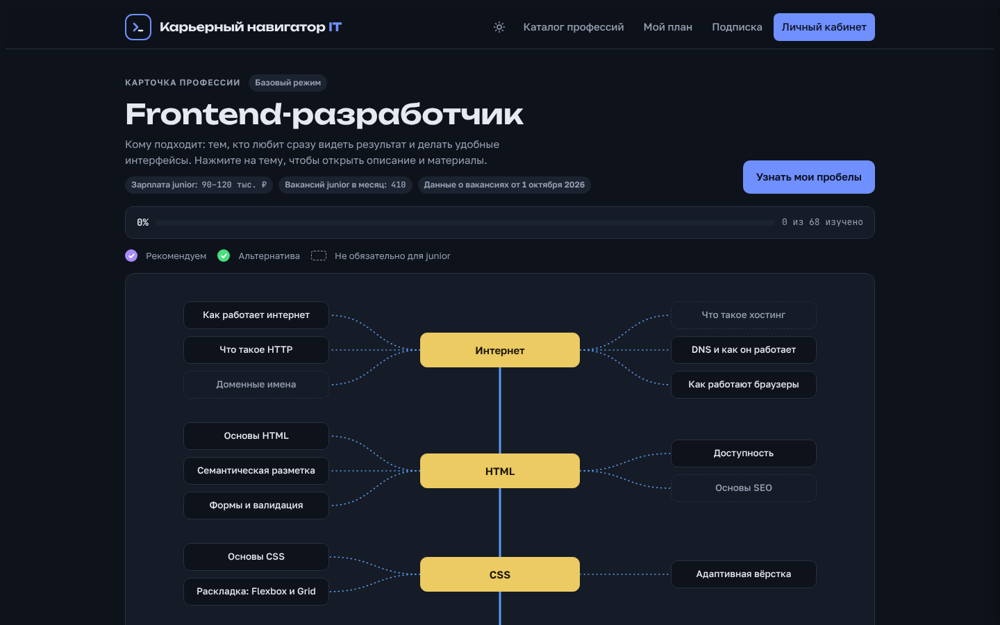
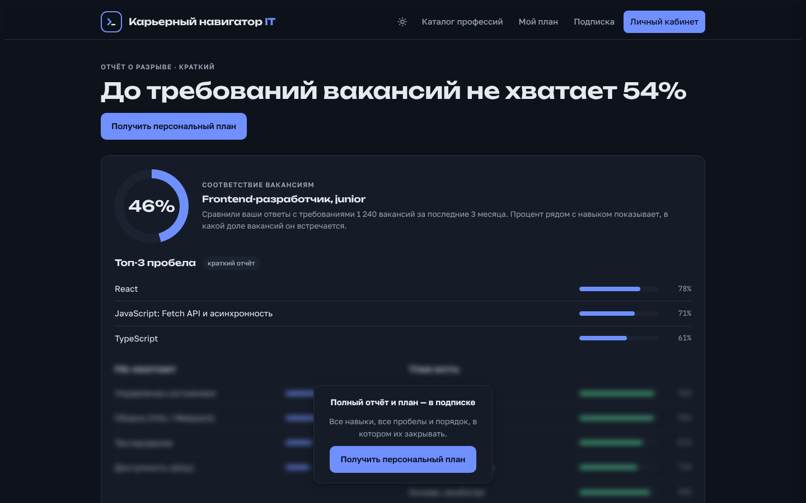
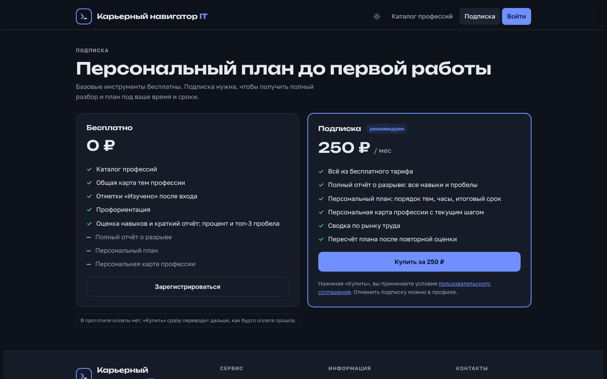
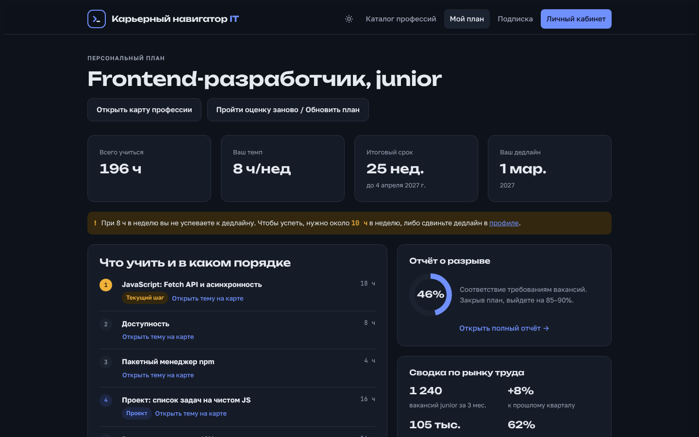

# Карьерный навигатор IT

Сервис для тех, кто хочет войти в IT: помогает выбрать профессию, оценить свои навыки и получить план обучения до первой работы.

**Сайт:** https://kayeros.github.io/IT-career-navigator/



## Как это работает

1. **Выбор профессии.** Каталог из 12 направлений или тест на профориентацию из 7 вопросов.
2. **Карта профессии.** Темы, которые нужно знать junior-специалисту, и как часто они встречаются в вакансиях.
3. **Оценка навыков.** Короткий опрос по темам выбранной профессии.
4. **Отчёт о разрыве.** Насколько человек соответствует требованиям вакансий и чего не хватает.
5. **Персональный план.** Что учить и в каком порядке, с учётом времени в неделю и желаемого срока.

Каталог, тест, карта профессии и краткий отчёт бесплатны. Полный отчёт и персональный план доступны по подписке за 250 ₽ в месяц.

## Скриншоты

| Карта профессии | Отчёт о разрыве |
| --- | --- |
|  |  |

| Подписка | Персональный план |
| --- | --- |
|  |  |

## О прототипе

Весь сайт в одном файле `index.html`, работает в браузере без сервера. Вход, оплата и результаты оценки имитируются, данные о профессиях и вакансиях записаны в коде. Полностью проработана профессия Frontend-разработчик.

Чтобы открыть локально, скачайте `index.html` и откройте его в браузере.

## Структура репозитория

Платформа — несколько сервисов, у каждого своя папка и свой Docker-контейнер.

| Путь | Что это | Кто ведёт |
| --- | --- | --- |
| `index.html`, `screenshots/` | Прототип сайта (GitHub Pages) | Евгений |
| `frontend/` | SPA на React + TypeScript + Vite | Евгений |
| `backend/` | API и фоновый воркер на Go (gin), миграции БД, seed-контент | Юрий |
| `collector/` | Сбор вакансий и расчёт весов навыков на Python | Юрий |
| `api/openapi.yaml` | Контракт API между фронтендом и бэкендом | Юрий |
| `docs/` | Документация: структура продукта, схема БД, план MVP, требования к фронтенду | команда |

Бэкенд, аналитика, контракт API и документация разрабатываются в рабочем репозитории и выгружаются сюда. Требования к фронтенду — `docs/frontend-requirements.docx`.

### Локальный запуск бэкенда

```bash
docker compose up --build -d
docker compose exec api /app/api seed
```

API — `http://localhost:8080/api/v1`, проверка — `http://localhost:8080/health`, демо-страница API — `http://localhost:8080/demo/`.

### Локальный запуск фронтенда

Нужен Node.js 20.19+ или 22.12+ (проверить: `node -v`).

1. Поднимите бэкенд (раздел выше) и создайте себе админа, если нужна админка:

   ```bash
   docker compose exec api /app/api create-admin you@example.ru
   ```

   Почту сначала зарегистрируйте на сайте, потом выполните команду. В Git Bash перед `docker compose exec` добавьте `MSYS_NO_PATHCONV=1`.

2. Во втором терминале запустите фронтенд:

   ```bash
   cd frontend
   npm ci          # один раз, ставит зависимости
   npm run dev
   ```

3. Откройте http://localhost:5173. Если страница не открывается, попробуйте http://127.0.0.1:5173. Запросы к `/api` Vite сам передаёт бэкенду на `localhost:8080`.

Без бэкенда фронтенд работает на мок-сервере: вместо шага 1 запустите `node mock/server.mjs` из папки `frontend` (порт 8080, данные в памяти). Демо-аккаунт: `demo@example.ru` / `demo1234`, с правами админа.

Остальные команды (сборка, тесты, линтер, генерация типов из `api/openapi.yaml`) и описание экранов — в [`frontend/README.md`](frontend/README.md).
