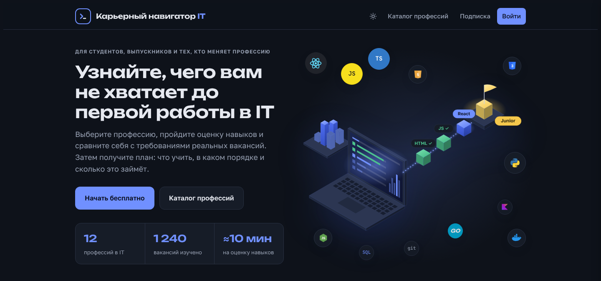
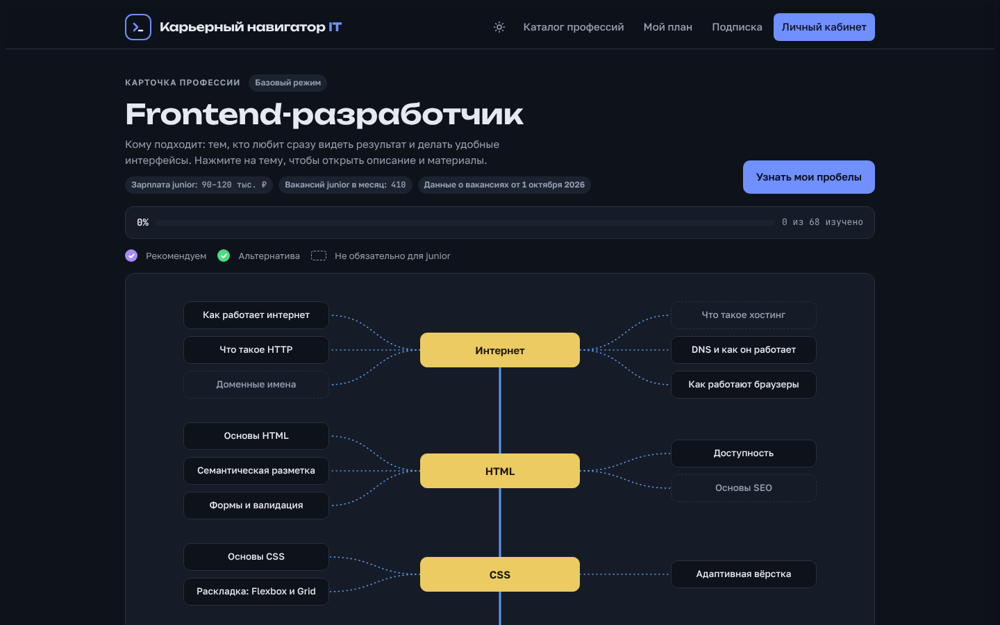
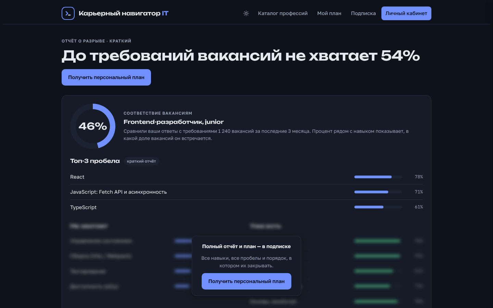
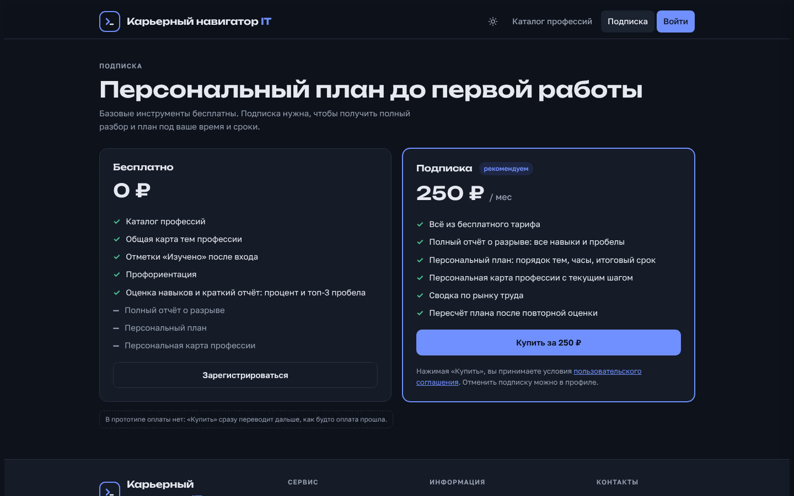
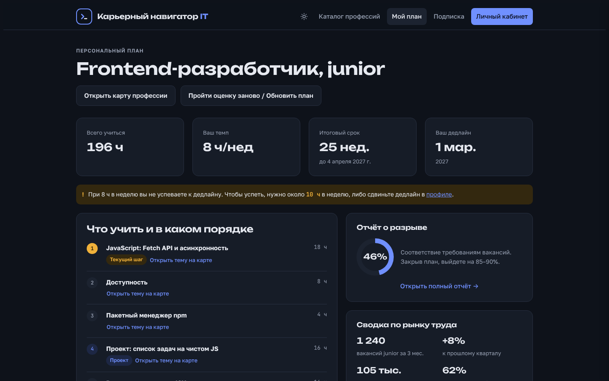

# Карьерный навигатор IT

Сервис для тех, кто хочет войти в IT: помогает выбрать профессию, оценить свои навыки и получить план обучения до первой работы.

**Сайт:** https://kayeros.github.io/IT-career-navigator/

## Как это работает

1. **Выбор профессии.** Каталог из 12 направлений или тест на профориентацию из 7 вопросов.
2. **Карта профессии.** Темы, которые нужно знать junior-специалисту, и как часто они встречаются в вакансиях.
3. **Оценка навыков.** Короткий опрос по темам выбранной профессии.
4. **Отчёт о разрыве.** Насколько человек соответствует требованиям вакансий и чего не хватает.
5. **Персональный план.** Что учить и в каком порядке, с учётом времени в неделю и желаемого срока.

Каталог, тест, карта профессии и краткий отчёт бесплатны. Полный отчёт и персональный план доступны по подписке за 250 ₽ в месяц.

## Скриншоты

| Карта профессии | Отчёт о разрыве |
| --- | --- |
|  |  |

| Подписка | Персональный план |
| --- | --- |
|  |  |

## О прототипе

Весь сайт в одном файле `index.html`, работает в браузере без сервера. Вход, оплата и результаты оценки имитируются, данные о профессиях и вакансиях записаны в коде. Полностью проработана профессия Frontend-разработчик.

Чтобы открыть локально, скачайте `index.html` и откройте его в браузере.
